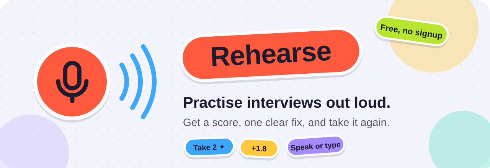
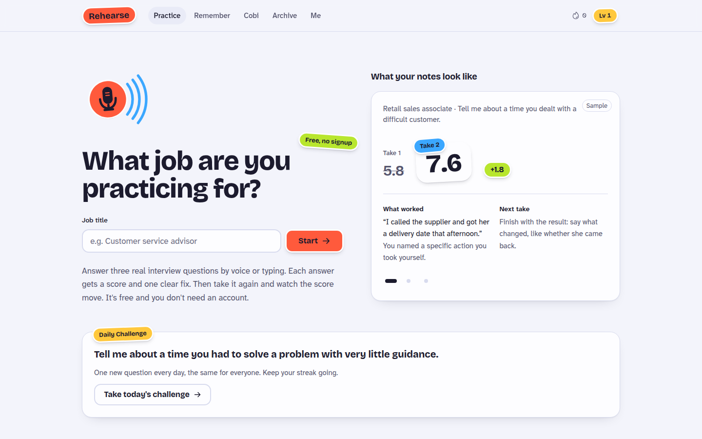
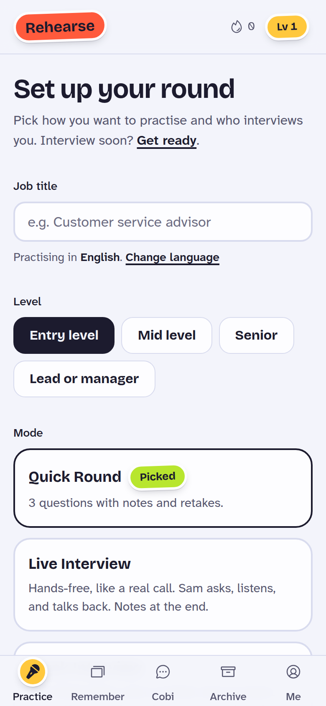
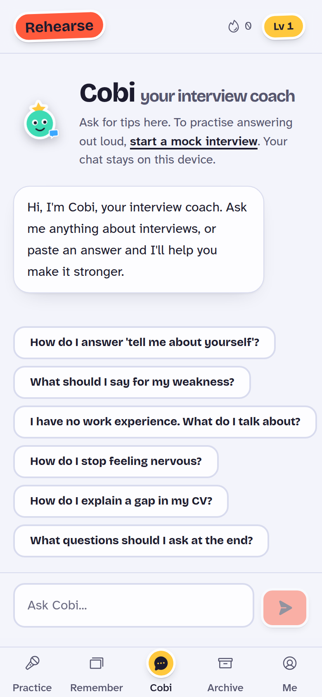
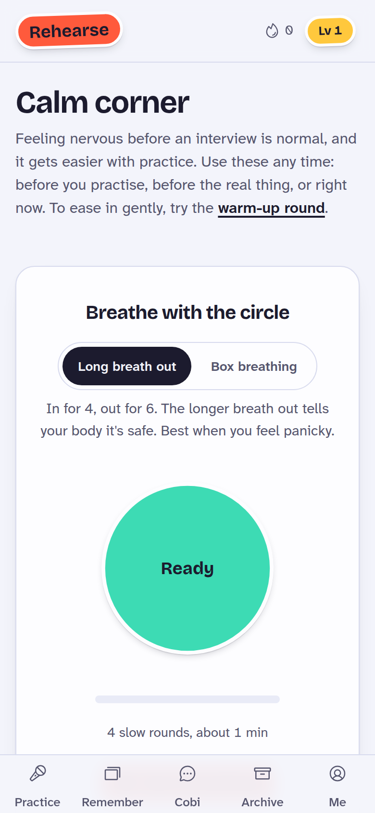

<div align="center">

<a href="https://rehearse.sayamdev.workers.dev/">
  
</a>

# A little practice. A clearer next answer.

**Free interview practice, with a score, one clear fix and another go.**

For your first job, your next role, or the question that always leaves you stuck.
Speak or type. Start small. No account needed.

**[Open Rehearse →](https://rehearse.sayamdev.workers.dev/)** · [Explore the tools](https://rehearse.sayamdev.workers.dev/prepare) · [Privacy](https://rehearse.sayamdev.workers.dev/privacy)

[Get started](#your-first-practice) · [What is inside](#find-your-way-around) · [Privacy and offline use](#your-words-your-progress) · [Run locally](#for-developers)



<sub>Product screenshots show example screens. Sample scores illustrate the feedback format, not measured user results.</sub>

</div>

---

## Your first practice

You do not need a polished answer to begin.

| Step | What to do |
|:---:|---|
| **01** | **Name the job.** Enter the role you are preparing for and start a round. |
| **02** | **Answer one question.** Speak out loud or type—both are supported. |
| **03** | **Read your notes.** See a score out of 10, what worked and one specific change to try. |
| **04** | **Take it again.** Put that change into your own words and compare your answers. |

Want a gentler start? Try an **unscored warm-up**. Preparing for the real thing? Choose a **full mock interview** or build a round from your **CV or job advert**.

> Scores are practice feedback, not a prediction of whether you will get a job. A retake is a chance to experiment; improvement is not guaranteed.

## Find your way around

| Place | What you can do |
|---|---|
| **[Practice](https://rehearse.sayamdev.workers.dev/)** | Start a Quick Round, take the Daily Challenge, or unlock Speed and Boss rounds as you progress. Live Interview offers a spoken, hands-free format in supported browsers. |
| **[Get ready](https://rehearse.sayamdev.workers.dev/prepare)** | Explore questions from a job advert or CV, build your introduction, choose questions to ask the interviewer and plan around your interview date. |
| **[Remember](https://rehearse.sayamdev.workers.dev/remember)** | Save useful answers, rewrite them in your own voice and practise recalling the key points. |
| **[Cobi](https://rehearse.sayamdev.workers.dev/coach)** | Talk through interview questions with the coach, from explaining a career gap to making an example more specific. |
| **[Calm corner](https://rehearse.sayamdev.workers.dev/calm)** | Take a breathing or grounding break, find a phrase for when your mind goes blank and prepare for interview day. |
| **[Me](https://rehearse.sayamdev.workers.dev/me)** | Review your progress, adjust voice and reading settings, and back up your practice data. |

### A look inside

<table>
<tr>
<td align="center" width="33%"><br><sub><b>Make room for a first attempt</b></sub></td>
<td align="center" width="33%"><br><sub><b>Work through it with Cobi</b></sub></td>
<td align="center" width="33%"><br><sub><b>Pause when you need to</b></sub></td>
</tr>
</table>

### Make it work for you

- **Speak or type.** Microphone access is optional; typing remains available when speech recognition is unsupported.
- **Practise in another language.** Questions and coaching support multiple languages. Translation coverage varies by screen; Live Interview is English-only.
- **Choose a comfortable pace.** Voice-speed, larger-text, simpler-wording and theme settings help you shape the experience. Soft mode keeps scores hidden until the round summary.
- **Build your collection.** Earn skill and achievement stickers, gain XP and see your practice history.
- **Prepare beyond the answer.** Use the camera self-check, body-language guide and printable interview-day card.

## Your words, your progress

**No account. No ads. Your saved practice stays in your browser.** Online AI and speech features still involve external services:

| What you use | What happens to your information |
|---|---|
| **Saved answers and progress** | Stored in your browser, without automatic account sync. Use **Me → Back up my progress** before clearing browser data or changing devices. Keep the backup private: it contains your answers. |
| **Online questions and feedback** | Relevant role information and answer text are sent to the configured AI provider. Built-in question and feedback fallbacks are available when online AI is unavailable. |
| **Voice answers** | Browser speech recognition may send audio to its provider. Enhanced transcription and Live Interview can also send audio to Groq. Typing avoids microphone transcription. |
| **Interviewer voices** | The optional Kokoro model runs on your device after downloading. Other voice paths can use Groq or your device's speech service. |
| **CV preparation** | The file is read on your device. Extracted text is processed to remove contact details before being sent for AI assistance; the original file is not uploaded. |
| **Camera and saved recordings** | The camera check is a local preview. Optional saved recordings stay in this browser and can be deleted. |

Read the **[full privacy explanation](https://rehearse.sayamdev.workers.dev/privacy)** for the hosted app's provider details and controls.

### What works offline?

After the production app has loaded and cached successfully, built-in questions, rule-based feedback and saved practice tools can work offline. Online AI, downloads and some speech features still need a connection. Install or add Rehearse to your home screen for easier access; keep a separate progress backup.

---

## For developers

<details>
<summary><b>Run Rehearse locally</b></summary>

<br>

Use **Node.js 22** and npm. From your checkout:

```bash
npm ci
npm run dev
```

Open **[localhost:3000](http://localhost:3000)**. Built-in questions and rule-based notes let you start without an AI key.

For optional AI configuration:

```bash
cp .env.example .env.local
```

Follow the comments in `.env.example` and the [developer guide](docs/DEVELOPER.md). Keep credentials server-side and out of commits. Optional providers include Groq and local Ollama; paid Claude use requires a separate explicit configuration flag.

</details>

<details>
<summary><b>Checks and Cloudflare deployment</b></summary>

<br>

| Command | Purpose |
|---|---|
| `npm test` | Run the Vitest unit tests |
| `npm run typecheck` | Generate route types and check TypeScript |
| `npm run lint` | Run ESLint |
| `npm run build` | Build the Next.js app for production |
| `npm run test:e2e` | Run Playwright browser tests |
| `npm run cf:preview` | Build and preview the Cloudflare Worker locally |
| `npm run cf:deploy` | Build and deploy to your configured Cloudflare Worker |

Browser tests require the browser configured in `playwright.config.ts`. For Cloudflare setup and secrets, follow the [deployment guide](docs/DEPLOY.md) before deploying.

</details>

<details>
<summary><b>How the project is organised</b></summary>

<br>

Built with **Next.js**, **React**, **TypeScript** and **Tailwind CSS**, hosted on **Cloudflare Workers** through OpenNext. Its visual language is a sticker book: paper-like panels, bold die-cut shapes and colour that marks actions and progress.

| Path | What to find |
|---|---|
| `src/app/` | Pages and server API routes |
| `src/components/` | Practice screens, coaching, voice and interface components |
| `src/lib/ai/` | AI providers, prompts, validation and built-in fallbacks |
| `src/lib/` | Scoring, progress, storage, speech and practice content |
| `public/` | Icons, animation assets and the production service worker |
| `docs/` | Product intent, design decisions and developer guidance |

Start with [Developer notes](docs/DEVELOPER.md), [Product](docs/PRODUCT.md), [Design system](docs/DESIGN.md) and [Deployment](docs/DEPLOY.md). Some planning sections describe earlier phases; check the current implementation for shipped behaviour.

</details>

---

<div align="center">

**Your next answer starts with one attempt.**

**[Start practising →](https://rehearse.sayamdev.workers.dev/)**

<sub>Made by Sayam Ajmal · Sister project: <a href="https://rehearse-courage.sayamdev.workers.dev/">Rehearse Courage</a>, small-step practice for speaking up.<br>
© 2026 Sayam Ajmal. All rights reserved. See <a href="LICENSE">LICENSE</a> for permissions.</sub>

</div>
